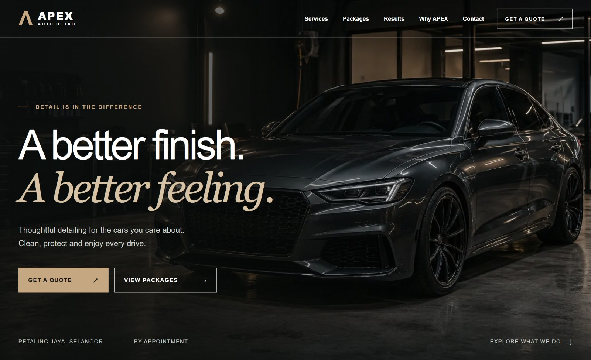

# APEX Auto Detail

APEX is my website concept for a **fictional Malaysian automotive detailing studio**. I wanted to take a business idea beyond a mockup and make something people could open, explore, and try on their own phones. The site is built with Next.js, React, and TypeScript.

[Visit the live demo](https://apex-auto-detail-demo.netlify.app/) · [Read the project story](docs/case-study.md)



## What you can explore

- Four service categories with matching imagery and icons
- Sample packages in Malaysian ringgit, FAQs, and studio information
- An interactive before/after comparison with touch, mouse, and keyboard controls
- Responsive navigation with keyboard focus and Escape support
- A frontend-only quote form that prepares a WhatsApp draft for manual review and sending
- General quote buttons that scroll to the form, plus direct WhatsApp and package-specific enquiry links
- A Maps link based on the configured address

This is a presentation demo, not an operating business. Business details, prices, reviews, and generated imagery are labelled as samples. The address is a placeholder. The WhatsApp number is my own, so quote messages reach me as the site's designer, not a detailing studio; quote links do not represent a real booking service. Search indexing remains disabled with `noindex, nofollow`.

## How I approached it

I brought APEX from an idea to a working demo with help from Codex. I guided the direction, gathered feedback, reviewed the design, and tested it on my laptop and Xiaomi 12T Pro. Codex handled the implementation and assisted with design, generated imagery, and technical checks. Later, Claude Code helped me organise the repository: a `develop` branch with protected branches, automatic checks on pull requests, and versioned releases. The [case study](docs/case-study.md) follows that collaboration, from the mobile scrolling fix to the quote form and later UI refinements.

The site uses Next.js 16 App Router, React 19, TypeScript, CSS, and local images served through `next/image`. It is hosted on Netlify from the `main` branch. There is no backend, booking system, or analytics integration.

## How changes reach the live site

Each change gets its own branch and pull request into `develop`. GitHub Actions runs the type check, formatting check, and production build on every pull request. When a set of changes is ready, I merge `develop` into `main`, tag a version under [Releases](https://github.com/Jrl1213/apex-auto-detail/releases), and publish it on Netlify. Both `main` and `develop` only accept changes through pull requests.

## Run locally

```bash
npm ci
npm run dev
```

Open `http://localhost:3000`.

```bash
npm run typecheck
npm run build
npm run start
```

The last command serves the production build locally.

## Project files

| Location                 | Purpose                                                     |
| ------------------------ | ----------------------------------------------------------- |
| `src/app/`               | Page layout, styles, and metadata                           |
| `src/components/`        | Navigation, branding, icons, and comparison slider          |
| `src/config/business.ts` | Business details, packages, FAQs, reviews, and quote links  |
| `public/images/`         | Images used by the website                                  |
| `docs/`                  | Case study, selected screenshots, and service image prompts |

I keep dependencies, build output, environment files, logs, and the local audit out of Git. I have included a small selection of screenshots from the published demo in `docs/screenshots/`.

## Configuration and real-world use

Update business content in `src/config/business.ts`. The business name, logo words, page description and every WhatsApp message come from there, so a copy for another studio starts in that one file. Longer page copy, such as headings, is in `src/app/page.tsx`. The [service image prompts](docs/service-image-prompts.md) document the four generated service visuals.

Before adapting the site for a real business, verify and replace the sample contact details, address, hours, prices, reviews, and imagery. Use licensed or permissioned customer material, update the disclosures and metadata, and remove `noindex, nofollow` only when the real details are ready.
