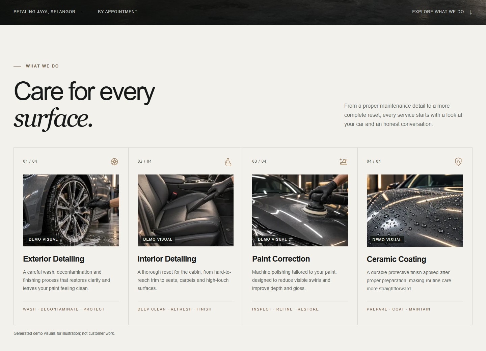
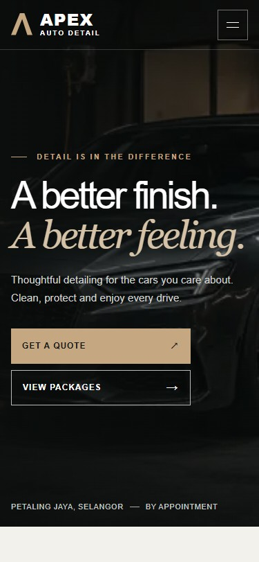
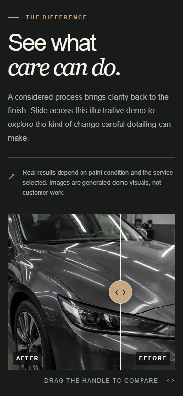

# APEX Auto Detail: from an idea to a working website

[Explore the live demo](https://apex-auto-detail-demo.netlify.app/) · [Back to the project](../README.md)

The part I am proudest of is seeing an idea become a website that people can actually open and use. APEX started as a fictional Malaysian detailing studio. It became a complete demo that I could share, review on my laptop, and test on my own phone.

## Starting with the visitor

I did not come into this project with experience in car detailing. That made a simple question useful: would someone unfamiliar with the subject understand what the studio offers?

I wanted visitors to understand the four services, compare sample packages, and find a clear way to ask for a quote. Keeping everything on one page made the demo straightforward to explore, with navigation to the main sections.

I later revisited the Why APEX copy to explain the approach more clearly: understand the car before recommending a service, take care through each step, and help the owner with aftercare. I wanted someone unfamiliar with detailing to understand what that care means.

## Finding the right look

I liked the combination of dark automotive imagery, warm gold accents, and lighter sections that give the information room to breathe. The large headings pair straightforward type with a softer italic style. I wanted the result to feel calm and polished on both a laptop and a small screen.

My first reviewer suggested adding more images. Four service visuals and matching icons gave each category something recognisable: wheel cleaning, cabin care, paint polishing, and protective water beading. We kept the existing typography and layout so the addition felt like part of the same design.

## The phone test that mattered

The before/after slider looked fine on a laptop, but on my phone it caught vertical swipes and made the page awkward to scroll. Allowing vertical panning solved that problem, then exposed another: horizontal finger dragging stopped working.

The final solution allows the browser to handle vertical scrolling and adds a small touch gesture handler for horizontal movement. The native range input still supports mouse dragging, keyboard arrows, and a visible focus ring.

I tested the published version on my Xiaomi 12T Pro and confirmed that both gestures worked smoothly. That was a useful reminder that a good desktop preview cannot tell the whole story.

  
  

The images above are browser screenshots at a phone viewport. I checked the gestures separately on my physical phone.

## Making the enquiry easier

I chose a short quote form inside the existing Contact section. It asks for a car make and model and a service, with optional space for the main concern and anything else the visitor wants to explain. Someone who is unsure can ask for help choosing.

The form prepares a WhatsApp draft. Visitors review and send the message themselves; the website does not store their enquiry or send it automatically. Keeping that distinction clear mattered to me, especially in a fictional demo.

The first version used a placeholder number. When I started showing APEX to real detailing businesses, Claude Code pointed out that the placeholder looked like a real Malaysian mobile number and could belong to a stranger, so anyone who tried the form might message the wrong person. I replaced it with my own number and changed the note to say that messages reach me as the site's designer.

I also wanted the general Get a Quote buttons to lead to the form, so visitors have a chance to explain what they need. Direct WhatsApp links remain available, and package enquiries keep the selected package in their prepared message.

## Polishing the details

On my phone, the opening-hours rows felt too close together. I asked for more breathing room and slightly larger text, with stacked days and times on narrower screens. The desktop layout stayed familiar.

The next pass focused on balanced heading wrapping, cleaner form borders and spacing, clearer focus states, and better alignment between the contact details and form. I wanted to improve the experience without changing the identity I already liked.

A later round with Codex made the before/after slider easier to discover. When it first scrolls into view, the divider moves once on its own to show that it can be dragged, then settles near the centre. It stops as soon as the visitor touches, clicks, or focuses it, and it does not play for visitors who have asked their device to reduce motion. The same round refined button and card hover effects so they only appear on devices with a mouse, and made navigation links at least 44 pixels tall for easier tapping.

## Working with AI

I brought APEX from an idea to a working demo with help from Codex. I guided the direction, gathered feedback, reviewed the design, and tested the experience. Codex handled the implementation and assisted with design, imagery, and technical checks. My contribution was in shaping the project, checking the result, and deciding when it felt ready to share.

In November 2026 I started working with Claude Code as well. It reviewed the project after I moved it into a folder with my notes, and helped me set up a safer workflow: a `develop` branch, protected `main` and `develop` branches, automatic checks on every pull request, and versioned releases. It also made the WhatsApp number change and updated these documents. I still review each pull request and test changes myself before merging.

## Where it landed

I published APEX on Netlify, connected to its GitHub repository. Before release, Codex checked the types, production build, responsive overflow, navigation, FAQs, quote links, mouse and keyboard controls, and visible focus. I reviewed the site on my laptop and phone, then tested the gestures again on the published version.

The quote form and UI refinements are now live too. Codex checked form validation, message encoding, quote navigation, keyboard focus, reduced motion, and responsive layouts in the browser. I reviewed the updated live site. These checks help me assess the demo; I have not measured real customer enquiries or conversion results.

I now tag each published version under the repository's Releases. Version 1.0.0 marks the first public demo; later versions add the slider demonstration, the refined hover effects, and my own WhatsApp number.

I am sharing APEX as a fictional portfolio demo. I have kept the prices, address, reviews, and generated visuals labelled as samples, with `noindex, nofollow` still in place. I am not presenting it as real customer work or claiming booking results or business performance.
